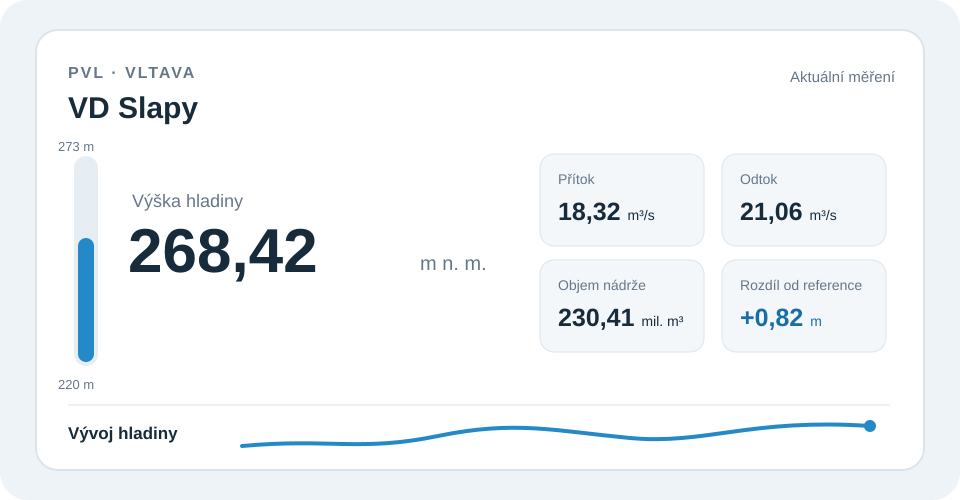

# PVL Reservoir Monitor Card

A responsive Lovelace card for the [PVL Reservoir Monitor integration](https://github.com/PetrOdst/PVL_Monitor). The integration provides current measurements for VD Slapy, VD Orlík, and VD Lipno I; this card presents selected sensors as a level gauge, measurement summary, and Recorder history chart.

The card is an independent community project. It reads Home Assistant states and history and does not connect to Povodí Vltavy.



## Requirements

- Home Assistant with the [PVL Reservoir Monitor integration](https://github.com/PetrOdst/PVL_Monitor) installed and configured.
- Home Assistant Recorder keeping history for the selected water-level sensor.

## Install with HACS

1. In HACS, open **Custom repositories** and add `PetrOdst/PVL_Monitor_lovelace` with category **Dashboard**.
2. Download **PVL Reservoir Monitor Card**.
3. If Lovelace resources are managed in YAML, add `/hacsfiles/PVL_Monitor_lovelace/PVL_Monitor_lovelace.js` as a JavaScript module resource.
4. Add a manual card and use the YAML example below.

HACS-managed dashboard resources are registered automatically. YAML-managed resources must be added manually.

## Manual installation

Copy `PVL_Monitor_lovelace.js` to the `www` directory in your Home Assistant configuration, then add `/local/PVL_Monitor_lovelace.js` as a JavaScript module resource.

## Card configuration

When adding or editing the card in the Home Assistant dashboard editor, choose the visual editor to select or clear sensors, rename the card and its displayed readings, adjust the gauge range, and show or hide the history chart. The same settings can still be entered as YAML.

```yaml
type: custom:pvl-reservoir-card
name: VD Slapy
level_entity: sensor.vd_slapy_pvl_reservoir_slapy_water_level
inflow_entity: sensor.vd_slapy_pvl_reservoir_slapy_inflow
outflow_entity: sensor.vd_slapy_pvl_reservoir_slapy_outflow
volume_entity: sensor.vd_slapy_pvl_reservoir_slapy_volume
precipitation_24h_entity: sensor.vd_slapy_pvl_reservoir_slapy_precipitation_24h
air_temperature_entity: sensor.vd_slapy_pvl_reservoir_slapy_air_temperature
reference_difference_entity: sensor.vd_slapy_water_level_difference_from_reference
min_level: 220
max_level: 273
show_history: true
```

The entity IDs above are examples. Home Assistant lets users rename entity IDs; check the configured entities if any ID is different. Configure the reference water level in the integration's **Configure** options. To display its difference in the card, set `reference_difference_entity` to the generated sensor. For Orlík or Lipno I, set the entity options to that reservoir's sensors and adjust `min_level` and `max_level` to its water-level range.

All options are optional and default to the Slapy measurement entities. Missing or unavailable entities are shown as unavailable without breaking the card.

Clear a metric's entity in the visual editor to remove that tile from the card. Leave an entity selected and change its label field to rename the tile.

## Options

| Option | Type | Default | Description |
| --- | --- | --- | --- |
| `name` | string | `VD Slapy` | Card heading. |
| `level_entity` | entity ID | `sensor.vd_slapy_pvl_reservoir_slapy_water_level` | Water-level sensor for the gauge and history chart. |
| `inflow_entity` | entity ID | `sensor.vd_slapy_pvl_reservoir_slapy_inflow` | Current inflow sensor. |
| `outflow_entity` | entity ID | `sensor.vd_slapy_pvl_reservoir_slapy_outflow` | Current outflow sensor. |
| `volume_entity` | entity ID | `sensor.vd_slapy_pvl_reservoir_slapy_volume` | Current reservoir volume sensor. |
| `precipitation_24h_entity` | entity ID | `sensor.vd_slapy_pvl_reservoir_slapy_precipitation_24h` | Rolling 24-hour precipitation sensor. |
| `air_temperature_entity` | entity ID | `sensor.vd_slapy_pvl_reservoir_slapy_air_temperature` | Current air-temperature sensor. |
| `reference_difference_entity` | entity ID | Not set | Optional integration sensor showing current level minus its configured reference. |
| `level_label` | string | `Výška hladiny` | Label shown beside the gauge value. |
| `inflow_label` | string | `Přítok` | Label for the inflow metric. |
| `outflow_label` | string | `Odtok` | Label for the outflow metric. |
| `volume_label` | string | `Objem nádrže` | Label for the reservoir volume metric. |
| `precipitation_24h_label` | string | `Srážky za 24 hodin` | Label for the precipitation metric. |
| `air_temperature_label` | string | `Teplota vzduchu` | Label for the air temperature metric. |
| `reference_difference_label` | string | `Rozdíl od referenční hladiny` | Label shown for the optional reference difference. |
| `min_level` | number (m) | `220` | Lower limit of the level gauge. |
| `max_level` | number (m) | `273` | Upper limit of the level gauge; must exceed `min_level`. |
| `show_history` | boolean | `true` | Show the one-hour and 24-hour Recorder history chart. |

The legacy `entities:` mapping (`water_level`, `inflow`, `outflow`, `volume`, `precipitation_24h`, `air_temperature`, `reference_difference`) is also supported. Explicit `*_entity` options take precedence. The card displays the difference sensor value supplied by the integration; it does not calculate or select reference levels.

## Development

The card is a single JavaScript module with no build step or third-party dependencies. HACS validation runs on pushes and pull requests.
